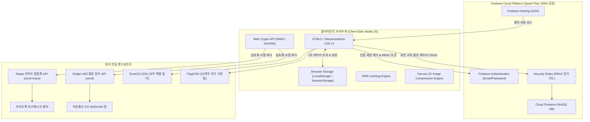
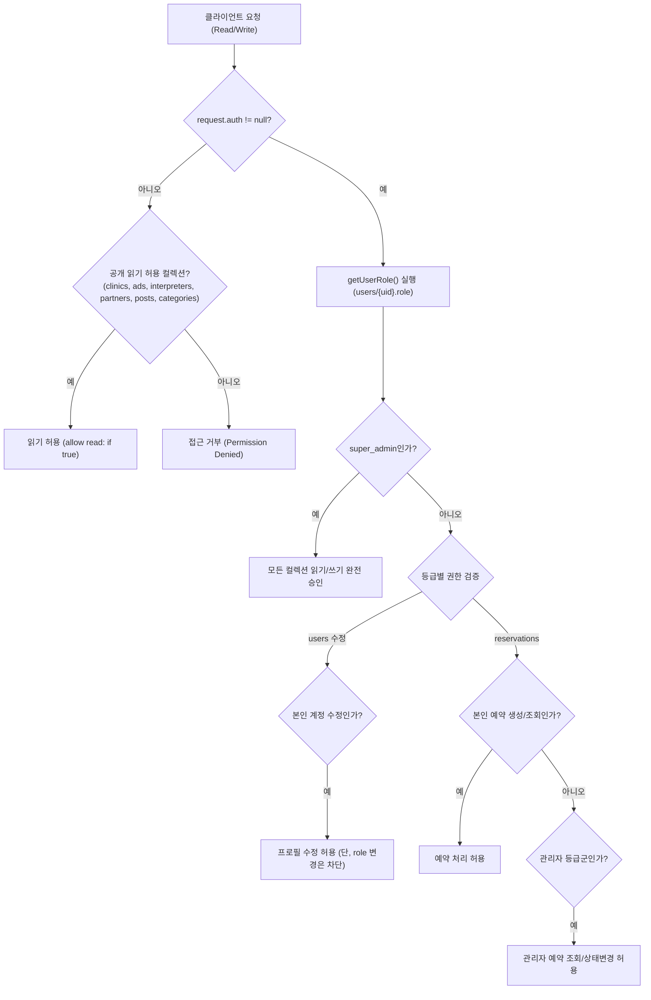

# IGPartners 전체 시스템 분석 보고서, 운영 매뉴얼 및 개발 견적서

본 문서는 `IGPartners` 글로벌 의료 매칭 예약 및 커뮤니티 플랫폼의 전체 코드베이스를 정밀 분석하여 작성된 기술 종합 보고서, 시스템 운영 매뉴얼, 그리고 소프트웨어 개발 견적서입니다. 신규 투입 개발자, 시스템 운영자, 비개발자 관리자 모두가 시스템의 구조와 동작 원리를 완전히 이해할 수 있도록 모든 변수, 함수, 알고리즘, 데이터 모델을 상세하게 설명합니다.

---

## 1. 시스템 개요 및 아키텍처 총론

### 1.1 시스템 개요
`IGPartners`는 국내 체류 외국인 및 다국적 환자를 위한 **다국어 의료 매칭 및 진료 예약 중계 플랫폼**입니다. 
15개국 언어 지원, 전담 의료 통역 매칭, 제휴 병원 및 협력업체 네트워크, 네이버 카페 스타일의 다기능 커뮤니티 게시판, Solapi 기반 실시간 알림톡/LMS 자동 발송 시스템, 그리고 강력한 관리자 통제 센터(RBAC 10대 권한 체계)를 갖추고 있습니다.

### 1.2 평생 무료 서버리스 아키텍처 (Zero-Cost Serverless)
본 시스템은 인프라 유지비용을 **영구적으로 0원에 수렴**시키기 위해 Google Cloud의 **Firebase Spark Plan(무료 플랜)**과 브라우저 클라이언트 사이드 기술을 극대화하여 설계되었습니다.

1. **상시 구동 WAS(Web Application Server) 배제**:
   - Node.js, Spring Boot, Django 등의 유료 가상머신/컨테이너 구동 비용이 발생하지 않습니다.
   - 모든 정적 자원(HTML, CSS, Vanilla JS)은 Google Global CDN(Firebase Hosting)을 통해 무료로 전송됩니다.
2. **Firestore NoSQL 읽기/쓰기 쿼리 비용 0원 유지 메커니즘**:
   - Firestore 무료 한도: 일일 읽기 50,000회, 일일 쓰기 20,000회.
   - 본 시스템은 **SWR(Stale-While-Revalidate) 3단계 캐싱**을 도입하여 브라우저의 `localStorage` 및 `sessionStorage`를 1차 캐시로 활용합니다.
   - 사용자가 페이지를 이동하거나 새로고침할 때 DB를 직접 조회하지 않고 로컬 캐시에서 즉시 화면을 렌더링하므로 불필요한 DB 읽기 트랜잭션이 발생하지 않습니다.
3. **Google CDN 기반 순수 모듈형 SDK 로드**:
   - 별도의 Webpack/Vite 번들링 단계 없이 Google 공식 CDN을 통해 ES6 모듈을 직접 로드합니다.

### 1.3 전체 시스템 아키텍처 구성도

---

## 2. 디자인 시스템 및 스타일 가이드 (`css/style.css`)

### 2.1 다크 테마 글래스모피즘 (Dark Glassmorphism) 디자인 토큰
`style.css`의 `:root` 가상 클래스에 정의된 주요 CSS 전역 변수 명세입니다:

| CSS 변수명 | 설정 값 | 역할 및 시각적 기능 |
| :--- | :--- | :--- |
| `--bg-main` | `#060913` | 전체 뷰포트의 기본 바탕색 (초심해 네이비) |
| `--bg-surface` | `#0c1020` | 모달, 대시보드 카드, 폼 박스의 표면 기본 배경색 |
| `--bg-glow` | `rgba(99, 102, 241, 0.12)` | 백그라운드 앰비언트 글로우(Ambient Glow) 오로라 조명 효과 광원 |
| `--text-primary` | `#f3f4f6` | 헤드라인, 굵은 텍스트, 중요 데이터 표시용 고대비 문자색 |
| `--text-secondary` | `#9ca3af` | 힌트, 레이블 설명, 보조 텍스트용 연회색 문자색 |
| `--accent-blue` | `#3b82f6` | 정보성 강조, 주요 링크 버튼 컬러 |
| `--accent-indigo` | `#6366f1` | 브랜드 대표 아이덴티티 및 기본 그라데이션 기점 컬러 |
| `--accent-purple` | `#8b5cf6` | 보조 액션 버튼 및 세련된 그라데이션 포인트 |
| `--glass-bg` | `rgba(255, 255, 255, 0.02)` | 유리 질감을 부여하는 극저투명 글래스 배경색 |
| `--glass-border` | `rgba(255, 255, 255, 0.06)` | 글래스 컨테이너의 은은한 미세 테두리 라인 |
| `--glass-border-hover` | `rgba(99, 102, 241, 0.4)` | 카드 요소 등에 마우스 호버 시 포인트 라인이 점등되는 효과 |
| `--transition-smooth` | `all 0.4s cubic-bezier(0.16, 1, 0.3, 1)` | 마우스 오버 및 상태 전이 시 부드러움을 극대화하는 베지에 곡선 |

### 2.2 반응형 레이아웃 및 뷰포트 제어
- **데스크톱 (Width > 1024px)**: 
  - 상단 헤더에 15개국어 드롭다운, 메인 메뉴, 내 정보 캡슐, 예약내역, 관리자, 예약통계 버튼이 가로로 전개됩니다.
- **모바일/태블릿 (Width <= 1024px)**:
  - 데스크톱 인증 영역이 모바일 햄버거 서랍장 드로어로 자동 병합됩니다.
  - 상단 2단 가로 스크롤 퀵 탭 바(`#nav-mobile-quick`)가 활성화되어 모바일 앱처럼 원터치 네비게이션을 지원합니다.
  - 미얀마어(`my`), 스리랑카어(`si`), 캄보디아어(`km`), 라오스어(`lo`), 네팔어(`ne`), 태국어(`th`), 방글라데시어(`bn`) 등 장문 텍스트 언어 선택 시 `.lang-compact-mode`가 활성화되어 폰트 크기와 패딩이 축소 조정됩니다.

---

## 3. 데이터베이스 모델 및 보안 규칙 (`firestore.rules`)

### 3.1 Cloud Firestore 10대 핵심 컬렉션 스키마 명세

#### ① `users` (회원 계정 컬렉션)
- **문서 식별자 (Doc ID)**: Firebase Auth 고유 UID (`request.auth.uid`)
- **필드 명세**:
  - `uid` (string): Firebase Auth 사용자 UID
  - `loginId` (string): 사용자 지정 로그인 아이디
  - `email` (string): 로그인 및 연락용 이메일
  - `name` (string): 사용자 실명 / 여권 영문명
  - `countryLanguage` (string): 선호 언어 코드 (ko, vi, en 등 15개국)
  - `dob` (string): 생년월일 (YYYY-MM-DD)
  - `alienNo` (string): 외국인등록번호 또는 주민등록번호 (마스킹 처리)
  - `phone` (string): 비상 연락처
  - `visaType` (string): 체류 비자 종류 (내국인, C-3-9, D-2, E-9 등)
  - `visaExpiry` (string): 체류 만료일 (외국인 필수)
  - `address` (string): 국내 체류 주소
  - `role` (string): 회원 등급 (`super_admin`, `admin`, `admin_user`, `top_manager`, `res_manager`, `partner`, `vip`, `general`, `user`)
  - `createdAt` (string/ISO-Timestamp): 가입 일시
  - `updatedAt` (string/ISO-Timestamp): 최근 정보 수정 일시

#### ② `reservations` (진료 예약 컬렉션)
- **문서 식별자 (Doc ID)**: Firestore 자동 생성 Auto-ID
- **필드 명세**:
  - `uid` (string): 예약을 신청한 회원의 UID
  - `name` (string): 환자 여권 영문명
  - `clinic` (string): 예약 진행 병원 영문 식별명
  - `gender` (string): 환자 성별 (남성 / 여성)
  - `alienNo` (string): 외국인등록번호
  - `visaType` (string): 비자 타입
  - `visaExpiry` (string): 체류 만료일
  - `dob` (string): 생년월일
  - `reservationDate` (string): 진료 희망 예약 날짜 (YYYY-MM-DD)
  - `reservationTime` (string): 진료 희망 시간 (HH:mm)
  - `address` (string): 체류지 주소
  - `symptoms` (string): 상세 임상 증상
  - `phone` (string): 환자 연락처
  - `lang` (string): 예약 신청 시 사용한 언어 코드
  - `inflow` (string): 환자 유입 경로 (관리자 대시보드에서 인라인 편집)
  - `status` (string): 예약 상태 (`pending`: 대기중, `confirmed`: 확정, `cancelled`: 취소)
  - `alimtalkStatus` (string): 관리자 알림톡 전송 결과 (`success`, `fail`, `not_configured`)
  - `alimtalkError` (string/null): 알림톡 실패 사유
  - `createdAt` (serverTimestamp): 서버 타임스탬프 기반 접수 일시

#### ③ `clinics` (협력 병원 및 지점 컬렉션)
- **문서 식별자 (Doc ID)**: Firestore Auto-ID 또는 병원 식별자
- **필드 명세**:
  - `name` (string): 기본 병원명 (한국어)
  - `englishName` (string): 데이터베이스 식별용 고유 영문 병원명
  - `image` (string): 병원 외경/내부 이미지 URL
  - `order` (number): 노출 순번 (오름차순 정렬)
  - `name_[lang]` (string): 15개국어 개별 병원명 (예: `name_vi`, `name_ja` 등)
  - `desc_[lang]` (string): 15개국어 병원 상세 소개문
  - `depts_[lang]` (array of strings): 15개국어 진료 과목 배지 목록
  - `address_[lang]` (string): 15개국어 병원 상세 지오 주소

#### ④ `roles` (접근 등급 및 10대 세부 권한 컬렉션)
- **문서 식별자 (Doc ID)**: 역할 키 문자열 (예: `super_admin`, `admin`, `user`)
- **필드 명세**:
  - `label` (string): 등급 한글 명칭 (예: "최고관리자", "예약 매니저")
  - `isAdmin` (boolean): 관리자 대시보드 진입 권한
  - `hasReservations` (boolean): 예약 관리 탭 열람 및 제어 권한
  - `hasClinics` (boolean): 협력 병원 CRUD 및 순서 변경 권한
  - `hasRoles` (boolean): 회원 목록 열람 및 정보 수정 권한
  - `hasPermissions` (boolean): 등급별 세부 권한 스위치 수정 권한 (오직 super_admin만 제어)
  - `hasStats` (boolean): 다각도 예약 통계 및 엑셀 다운로드 권한
  - `hasAds` (boolean): 광고 배너 CRUD 및 슬라이더 간격 설정 권한
  - `hasPartners` (boolean): 협력업체 CRUD 및 순서 변경 권한
  - `hasInterpreters` (boolean): 전문 의료 통역사 프로필 CRUD 권한
  - `hasCommunitySettings` (boolean): 커뮤니티 카테고리 관리 및 열람/쓰기 권한 제어
  - `isSystem` (boolean): 시스템 필수 기본 등급 여부

#### ⑤ `ads` (홈페이지 롤링 광고 배너 컬렉션)
- **문서 식별자 (Doc ID)**: Firestore Auto-ID
- **필드 명세**:
  - `tag` (string): 제휴사 태그/업종
  - `title` (string): 광고 헤드라인
  - `desc` (string): 상세 소개문
  - `slideInterval` (number): 이미지 개별 롤링 시간 (밀리초, 예: 4000)
  - `order` (number): 노출 순번
  - `images` (array of strings): 순환 출력할 이미지 URL 목록

#### ⑥ `partners` (공식 협력업체 컬렉션)
- **문서 식별자 (Doc ID)**: Firestore Auto-ID
- **필드 명세**:
  - `title` (string): 협력업체 사명
  - `subtitle` (string): 사업 분야 / 제휴 내용 요약
  - `tag` (string): 분류 태그 (예: 치과, 법률, 뷰티, 여행 등)
  - `imageUrl` (string): 업체 로고 이미지 URL
  - `linkUrl` (string): 공식 웹사이트 외부 링크 URL
  - `isActive` (boolean): 활성화 여부
  - `order` (number): 노출 순번

#### ⑦ `interpreters` (전문 의료 통역사 컬렉션)
- **문서 식별자 (Doc ID)**: Firestore Auto-ID
- **필드 명세**:
  - `type` (string): 통역사 구분 (`staff`: IGPartners 전속 소속, `freelance`: 전문 프리랜서)
  - `name` (string): 통역사 성명 (현지어 및 한글 병기)
  - `country` (string): 대상 국가명
  - `countryCode` (string): 국가 2자리 코드 (kr, vn, ru 등)
  - `flag` (string): 국기 이미지 URL (FlagCDN)
  - `phone` (string): 통역사 비상 연락처
  - `email` (string): 공식 이메일
  - `image` (string): 프로필 사진 URL (소속 통역사 전용)
  - `order` (number): 노출 순번

#### ⑧ `community_posts` (커뮤니티 게시글 및 하위 댓글 컬렉션)
- **문서 식별자 (Doc ID)**: Firestore Auto-ID
- **필드 명세**:
  - `category` (string): 게시판 카테고리 ID (`notice`, `clinic`, `insurance`, `visa`, `job`, `resume` 등)
  - `title` (string): 게시글 제목
  - `content` (string): 스마트 에디터 HTML 본문 (인라인 압축 이미지 포함)
  - `authorUid` (string): 작성자 UID
  - `authorName` (string): 작성자 성명 / 닉네임
  - `authorRole` (string): 작성 당시 회원 등급
  - `isNotice` (boolean): 상단 공지사항 고정 여부
  - `viewCount` (number): 조회수 (`increment(1)` 원자적 카운트)
  - `likeCount` (number): 추천수
  - `commentCount` (number): 등록 댓글 수
  - `photos` (array of objects): 첨부 사진 배열
  - `files` (array of objects): 첨부 파일 배열 (파일명, 크기, base64)
  - `createdAt` (serverTimestamp): 작성 일시
- **하위 서브컬렉션 `comments`**:
  - `authorUid` (string), `authorName` (string), `content` (string), `createdAt` (serverTimestamp)

#### ⑨ `deleted_community_posts` (삭제 게시글 백업 보관소)
- 게시글 삭제 시 완전 파기 대신 백업 보관하여 분쟁 방지 및 복구 지원.

#### ⑩ `settings` (시스템 공통 설정)
- `settings/solapi`: `adminPhones` (알림톡 수신 관리자 전화번호 배열), `senderNumber` (업무폰 발신번호)
- `settings/community_categories`: 동적 커뮤니티 카테고리 정의 객체 배열

### 3.2 보안 규칙 (`firestore.rules`) 인가 매트릭스 분석

---

## 4. 프론트엔드 모듈별 소스코드 정밀 분석

### 4.1 `js/firebase-db.js`
- **목적**: Firebase App, Firestore, Auth, Analytics SDK의 싱글톤 초기화 및 인스턴스 전역 내보내기.
- **주요 변수**:
  - `firebaseConfig`: Google Cloud 프로젝트 API 키, 인증 도메인, 프로젝트 ID, 버킷, 앱 ID가 담긴 설정 객체.
  - `app`: `getApps().length === 0 ? initializeApp(firebaseConfig) : getApp()` 패턴을 적용하여 중복 초기화를 방지한 싱글톤 인스턴스.
  - `db`, `auth`, `analytics`: Firestore, Auth, Analytics 서비스 인스턴스.

### 4.2 `js/navigation.js`
- **목적**: 15개국어 전역 언어 설정, 다국어 네비게이션 동적 렌더링, 공통 헤더/푸터 주입 및 모바일 인터랙션 제어.
- **주요 변수**:
  - `LANG_LIST`: 15개국 언어의 2글자 코드(`code`), 원어 표기(`native`), 한국어 표기(`koName`), 고화질 국기 이미지 URL(`flag`)을 정의한 불변 기준 데이터.
  - `MENU_TRANSLATIONS`: 상단 13개 메뉴 항목(홈, 회사소개, 제공서비스, 전문통역, 진료예약, 협력업체, 커뮤니티, 예약내역, 관리자, 통계 등)의 15개국어 번역 딕셔너리.
- **주요 함수**:
  - `changeGlobalLanguage(langCode)`: 선택된 언어를 `localStorage("app_selected_language")`에 저장하고, 메뉴 텍스트와 드롭다운 스타일을 즉시 갱신하며 전역 커스텀 이벤트 `appLanguageChanged`를 브로드캐스트.
  - `applyNavTranslations(langCode)`: 헤더 메뉴와 모바일 퀵바의 DOM 텍스트를 실시간 변경하고, 장문 언어군 감지 시 `.lang-compact-mode` CSS 클래스 토글.
  - `createLangDropdownHTML()` / `bindLangDropdownList()`: 15개국 국기 및 언어명이 포함된 세로 드롭다운 패널 HTML 생성 및 클릭 이벤트 위임 바인딩.

### 4.3 `js/auth.js`
- **목적**: 회원가입, 로그인, 세션 유지, 내 정보 관리(마이페이지), 비밀번호 변경, 10대 세부 권한 실시간 파이프라인.
- **주요 변수**:
  - `unsubscribeLiveUser`, `unsubscribeLiveRole`: 등급 및 권한 실시간 감지용 Firestore 리스너 해제 함수 포인터.
- **주요 함수**:
  - `handleSignUpSubmit(e)`: 회원가입 폼 제출 핸들러. 12가지 항목(국가, 아이디, 이메일, 비밀번호, 성명, 생년월일, 외국인등록번호, 연락처, 비자타입, 비자만료일, 체류주소, 개인정보동의) 유효성 검사, 아이디 중복 체크(`limit(1)` 최적화 쿼리), Firebase Auth 계정 생성 및 Firestore `users/{uid}` 문서 저장. (관리자 이메일 `ispartners82@gmail.com` 가입 시 `super_admin` 등급 자동 부여).
  - `handleLoginSubmit(e)`: 아이디/이메일 하이브리드 로그인. 아이디 입력 시 Firestore에서 `loginId`로 이메일을 역추적 조회하여 로그인 처리.
  - `showProfileModal()` / `handleProfileInfoSubmit(e)`: 마이페이지 모달 열기 및 개인정보 실시간 업데이트.
  - `handleProfilePasswordSubmit(e)`: `reauthenticateWithCredential`을 통해 현재 비밀번호를 재검증한 후 안전하게 새 비밀번호로 업데이트.
  - `getCachedRolePermissions(userRole)`: 등급별 10개 세부 권한(hasReservations, hasClinics 등)을 `sessionStorage`에 캐싱하여 Firestore 읽기 비용을 절감.
  - `onAuthStateChanged(auth, user)`: 로그인 세션 감지 후 상단 프로필 표출, `users/{uid}` 및 `roles/{activeRole}` 동시 실시간 리스너 구동을 통해 관리자가 권한 스위치를 누르는 즉시 0.1초 만에 UI 반영.

### 4.4 `js/ad-slider.js`
- **목적**: 홈페이지 메인 제휴 광고 배너의 Stale-While-Revalidate 초고속 렌더링 및 개별 롤링 타이머 구동.
- **주요 변수**:
  - `CACHE_KEY`: 로컬 스토리지 캐시 키 (`cached_home_ads_data`).
  - `FALLBACK_ADS`: DB가 비어있을 때 정돈감을 유지하기 위한 8개의 고화질 웰니스 파트너 샘플 데이터 배열.
  - `activeSliderIntervals`: 구동 중인 `setInterval` 타이머 ID를 보관하는 배열로, 화면 재렌더링 시 메모리 누수를 방지하기 위해 일괄 클리어.
- **주요 함수**:
  - `renderAds(list)`: 광고 카드를 동적 생성하고, 각 광고 카드에 설정된 `slideInterval`(ms) 간격으로 이미지를 순환시키는 타이머 가동.
  - `initPage()`: 1단계 로컬 캐시에서 0.01초 즉시 렌더링 -> 2단계 Firestore 백그라운드 비동기 조회 -> 3단계 변경 감지 시 UI 및 캐시 자동 동기화.

### 4.5 `js/clinic-loader.js`
- **목적**: `booking-clinic.html`의 15개국어 병원 목록 로딩 및 맞춤 필터링.
- **주요 함수**:
  - `renderClinicsList(clinicsData, targetContainer, lang, dictionary)`: 다국어 필드 접미사(`name_vi`, `desc_vi`, `depts_vi`)를 우선 바인딩하고 누락 시 한국어 기본값으로 Fallback 처리. Google Maps 검색 링크 자동 바인딩.
  - `selectClinic(clinicEnglishName, clinicLocalizedName)`: 로그인 여부 확인(비로그인 시 로그인 모달 호출), 선택 병원 식별자를 `localStorage`에 저장 후 예약 폼으로 안전하게 리다이렉트.

### 4.6 `js/i18n-reservation.js`
- **목적**: 예약 신청 폼의 15개국어 라벨, 플레이스홀더, 버튼, 시스템 알림 문구 및 개인정보 수집 이용 안내문(약관)을 집중 관리하는 리소스 모듈.
- **주요 객체**:
  - `i18n`: 15개국 언어별 폼 UI 텍스트 사전.
  - `privacyContents`: 15개국 언어별 개인정보 처리방침 전문 HTML.

### 4.7 `js/reservation.js`
- **목적**: 진료 예약 신청 폼 작성, 로그인 회원 정보 자동완성, Solapi HMAC-SHA256 암호화 알림톡 발송, Firestore 예약 데이터 원자적 저장.
- **주요 상수**:
  - `SOLAPI_API_KEY`, `SOLAPI_API_SECRET`, `SOLAPI_PF_ID`, `SOLAPI_TEMPLATE_ID`, `SOLAPI_SENDER_NUMBER`.
- **주요 함수**:
  - `createSolapiAuthHeader(apiKey, apiSecret)`: Web Crypto API를 활용하여 `HMAC-SHA256 apiKey=..., date=..., salt=..., signature=...` 표준 규격 인증 헤더 생성.
  - `sendSolapiAlimtalk(...)`: Firestore `settings/solapi`에서 등록된 관리자 휴대폰 번호 목록을 조회하고, 솔라피 다중 발송 엔드포인트(`/messages/v4/send-many`)로 승인된 카카오 알림톡 템플릿 10가지 변수를 매핑하여 전송.
  - `reservationForm.addEventListener("submit", ...)`: 폼 유효성 검사, 알림톡 선발송 수행, `reservations` 컬렉션에 `alimtalkStatus` 및 `serverTimestamp()`와 함께 원자적 단일 트랜잭션 기록.

### 4.8 `js/my-reservations.js`
- **목적**: 로그인한 사용자의 본인 예약 내역 실시간 조회, 통계 카운터, 예약 취소 액션.
- **주요 함수**:
  - `loadMyReservations(user)`: 인덱스 오류를 차단한 `where("uid", "==", user.uid)` 쿼리 실행. 로컬 스토리지 데이터 선렌더링 후 Firestore 실시간 `onSnapshot` 구독. `Map` 객체를 이용한 중복 제거 및 최신순 병합 정렬.
  - `renderReservations(items)`: 상태 뱃지(`pending`, `confirmed`, `cancelled`) 및 취소 버튼 렌더링. 대기 상태일 때만 취소 허용.

### 4.9 `js/community.js`
- **목적**: 네이버 카페 스타일의 대규모 커뮤니티 엔진 (2,731 라인).
- **주요 변수**:
  - `DEFAULT_CATEGORIES`: 기본 6대 카테고리(공지사항, 병원정보, 보험정보, 비자정보, 구인구직, 이력서업로드) 정의.
  - `currentBoard`, `itemsPerPage`, `currentPage`, `periodFilter`, `targetFilter`, `keywordFilter`: 다각도 게시판 필터링 및 페이징 상태 변수.
- **주요 함수**:
  - `insertImageAtCursor(imgDataUrl, fileName)`: 네이버 스마트 에디터 스타일의 인라인 대형 사진 커서 위치 삽입 및 실시간 삭제 버튼 바인딩.
  - `compressImage(inputData, maxDimension, quality)`: Canvas 2D를 활용하여 가로/세로 900px 초과 시 비율 유지 축소 및 JPEG 72% 고효율 압축을 수행하는 다형성 압축 엔진.
  - `renderSidebarMenu()` / `renderWriteBoardSelect()`: 카테고리별 글 수, 열람 권한, 쓰기 등급 필터링 렌더링.
  - `handlePostSubmit()`: 게시글 등록/수정. XSS 방어, 압축 이미지 인라인 결합, Firestore `community_posts` 저장.
  - `openPostDetail(postId)`: 게시글 상세 모달 호출, `increment(1)`을 통한 원자적 조회수 증가, 추천(좋아요), 댓글/답글 실시간 리스너 연결.

### 4.10 `js/partners.js` & `js/interpreters.js`
- **목적**: 제휴 파트너사 및 전문 의료 통역사 네트워크 동적 렌더링.
- **주요 기능**: SWR 캐싱 기반 0.01초 즉시 렌더링, 관리자 수정 사항 `onSnapshot` 실시간 자동 동기화, 외부 공식 링크 연동, 소속/프리랜서 통역사 명함형 카드 렌더링.

### 4.11 `js/stats.js`
- **목적**: 예약 데이터 다각도 복합 필터링, 실시간 집계 카드, ExcelJS 기반 고품질 서식 엑셀 파일 내보내기.
- **주요 함수**:
  - `applyFiltersAndRender(items)`: 언어, 병원, 성별, 유입경로(`inflow`), 체류만료일, 접수일, 희망일 등 7가지 복합 조건 필터링.
  - `openExcelPreview()` / `downloadStyledExcel()`: ExcelJS 라이브러리를 동적 파싱하여 에메랄드 헤더 채우기, 텍스트 줄바꿈, 얇은 테두리선, 상태별(확정: 연녹색, 취소: 연적색) 셀 색상 서식이 적용된 전문 보고서 엑셀 파일 자동 생성 및 다운로드.

### 4.12 `js/admin.js`
- **목적**: 플랫폼 전체를 통제하는 초대형 관리자 통합 컨트롤러 (5,323 라인).
- **주요 하위 모듈**:
  1. **솔라피 고객 LMS 자동 발송 엔진**:
     - `sendCustomerStatusLms(resData, statusType)`: 관리자가 예약 확정 또는 취소 버튼을 누를 때, 환자의 휴대폰 번호로 업무폰 발신번호(`01048444115`)를 통해 상세 안내 LMS 장문 문자 자동 전송. 전송 후 1.2초 대기하여 통신사 번호도용차단 서비스 등 차단 여부를 2차 검증.
  2. **예약 통합 관리 (`tab-reservations`)**:
     - 실시간 예약 조회, 언어별/검색어별 필터링, 예약 건수 제한(10/20/50개), 인라인 유입경로(`inflow`) 실시간 타이핑 저장, 예약 상태 전환(`confirm`, `cancel`, `pending`), 영구 삭제.
  3. **회원 계정 및 권한 관리 (`tab-users`, `tab-roles`)**:
     - 가입 회원 페이징 조회, 회원 상세 모달, 회원 등급 변경, 10대 세부 권한 토글 스위치, 신규 등급 생성 및 삭제.
  4. **협력 병원 CRUD 및 드래그앤드롭 (`tab-clinics`)**:
     - 병원 등록/수정 모달, 15개국어 병원명/소개문/진료과목 동적 입력 필드, HTML5 Drag & Drop 마우스 드래그를 통한 노출 순서 변경 및 Firestore `writeBatch()` 원자적 일괄 저장.
  5. **광고 배너 및 파트너/통역사 관리 (`tab-ads`, `tab-partners`, `tab-interpreters`)**:
     - 광고 배너 슬라이드 이미지 다중 관리, 롤링 주기 설정, 협력업체 및 통역사 프로필 등록/수정/삭제 및 순서 드래그앤드롭.
  6. **솔라피 설정 관리 (`tab-settings`)**:
     - 알림톡 수신 관리자 휴대폰 번호 추가/삭제, 문자 발신번호 변경 설정.

---

## 5. 적용된 9대 핵심 특화 알고리즘 및 설계 패턴 심층 분석

```mermaid
flowchart TD
    subgraph SWR_Pattern ["1. SWR 3단계 캐싱 알고리즘"]
        Step1["1단계: Stale - LocalStorage 캐시로 0.01초 즉시 화면 렌더링"]
        Step2["2단계: Revalidate - Firestore 백그라운드 비동기 조회"]
        Step3["3단계: Update - JSON 비교 후 변경 감지 시 UI 및 캐시 갱신"]
        Step1 --> Step2 --> Step3
    end

    subgraph Crypto_Pattern ["2. Web Crypto HMAC-SHA256 서명 알고리즘"]
        RawKey["API Secret Key"] --> ImportKey["crypto.subtle.importKey (Raw)"]
        MsgData["Date ISO String + Random Salt (36진수)"] --> SignData["crypto.subtle.sign (HMAC SHA-256)"]
        ImportKey --> SignData
        SignData --> HexString["Uint8Array -> Hex 다이제스트 문자열 변환"]
    end

    subgraph Canvas_Pattern ["3. Canvas 2D 이미지 리사이징 & 고효율 압축"]
        FileIn["File / Blob / DataURL"] --> ImgLoad["Image 객체 로드 및 원본 크기 측정"]
        ImgLoad --> CalcRatio{"가로/세로 > 900px?"}
        CalcRatio -- 예 --> AspectCalc["종횡비 유지 비례 축소 (Math.round)"]
        CalcRatio -- 아니오 --> KeepSize["원본 크기 유지"]
        AspectCalc --> CanvasDraw["canvas.getContext('2d').drawImage"]
        KeepSize --> CanvasDraw
        CanvasDraw --> JpegCompress["canvas.toDataURL('image/jpeg', 0.72)"]
    end
```

### 5.1 SWR (Stale-While-Revalidate) 3단계 캐싱 알고리즘
- **적용처**: `ad-slider.js`, `clinic-loader.js`, `partners.js`, `interpreters.js`
- **원리**: 사용자가 화면에 진입하는 순간 로딩 스피너를 보여주는 대신, 로컬 스토리지에 캐시된 데이터를 즉시 렌더링하여 화면 딜레이를 0.01초로 단축합니다. 이후 백그라운드에서 Firestore 비동기 조회를 수행하여 신규/수정 데이터가 있을 때만 화면과 캐시를 업데이트합니다.

### 5.2 Web Crypto API 기반 HMAC-SHA256 디지털 서명 알고리즘
- **적용처**: `reservation.js`, `admin.js`
- **원리**: 외부 무단 도용 방지를 위해 Solapi API 호출 시마다 `crypto.subtle.importKey`와 `crypto.subtle.sign`을 이용하여 `API Secret Key`와 `Date + Random Salt`를 결합한 암호화 다이제스트를 생성하고, 표준 Authorization 헤더를 조립하여 전송합니다.

### 5.3 Canvas 2D 다형성 이미지 자동 리사이징 & 고효율 압축 엔진
- **적용처**: `community.js`
- **원리**: 사용자가 고해상도(예: 4K, 10MB 이상) 사진을 첨부하더라도 브라우저 메모리 상에서 `Canvas 2D` 컨텍스트를 생성하여 최대 변을 900px로 다운스케일링하고 JPEG 품질 72%로 압축합니다. 이를 통해 이미지 용량을 수십 KB 단위로 줄여 Firestore 무료 용량 한도를 완벽히 준수합니다.

### 5.4 HTML5 Drag & Drop 원자적 순서 스왑 및 Firestore WriteBatch 알고리즘
- **적용처**: `admin.js` (병원, 광고, 협력업체, 통역사 순서 변경)
- **원리**: 관리자가 마우스로 행을 드래그하여 놓으면 DOM 인덱스를 즉시 스왑하고, 변경된 순번(`order`)을 Firestore `writeBatch()`를 통해 단일 네트워크 요청으로 일괄 커밋하여 데이터 정합성을 보장합니다.

### 5.5 가로 드래그 스크롤 (Drag-to-Scroll) 마우스 물리 인터랙션
- **적용처**: `admin.js` 테이블 컨테이너
- **원리**: 모바일뿐만 아니라 데스크톱 환경에서도 넓은 테이블을 직관적으로 탐색할 수 있도록 마우스 드래그 시작 좌표(`startX`)와 스크롤 위치(`scrollLeft`)의 오프셋을 계산하여 부드러운 패닝 인터랙션을 제공합니다.

### 5.6 ExcelJS 기반 셀 서식 및 조건부 스타일링 엑셀 빌더
- **적용처**: `stats.js`
- **원리**: 브라우저 상에서 `ExcelJS` 라이브러리를 동적으로 활용하여 에메랄드 테마 헤더, 테두리선, 줄바꿈, 열 너비 자동 산출, 예약 상태별 조건부 배경색을 입힌 정밀 엑셀 문서를 실시간 생성합니다.

---

## 6. 시스템 운영 및 관리자 실전 매뉴얼

### 6.1 관리자 대시보드 접근 및 권한 관리
1. **관리자 접속**:
   - 우측 상단 `로그인` 버튼을 클릭하여 관리자 계정으로 로그인합니다.
   - 최고 관리자 권한을 가진 계정으로 로그인 시 상단 네비게이션에 `👑 관리자` 및 `📊 예약통계` 버튼이 자동으로 활성화됩니다.
2. **회원 등급 및 세부 권한 설정 (`등급 및 권한 설정` 탭)**:
   - 각 회원 등급(예: 일반관리자, 예약매니저 등)별로 10가지 세부 기능 권한 스위치를 토글할 수 있습니다.
   - 스위치를 변경하는 즉시 Firestore `roles` 컬렉션에 동기화되며, 접속 중인 해당 등급 사용자의 브라우저 화면에 0.1초 만에 권한이 실시간 반영됩니다.

### 6.2 진료 예약 접수 및 고객 LMS 자동 발송 운영
1. **예약 확인 (`진료 예약 관리` 탭)**:
   - 환자가 신청한 여권 성명, 병원, 성별, 비자, 체류만료일, 희망일시, 증상, 연락처를 확인합니다.
   - `유입경로` 칸을 클릭하여 광고 매체나 소개 경로를 인라인으로 직접 입력하면 즉시 자동 저장됩니다.
2. **예약 확정 및 취소 처리**:
   - `예약 확정` 클릭: 예약 상태가 즉시 확정(`confirmed`)으로 전환되며, 환자 연락처로 [진료 예약 확정 안내] LMS 장문 문자가 자동으로 발송됩니다.
   - `예약 취소` 클릭: 예약 상태가 취소(`cancelled`)로 전환되며, 환자 연락처로 [진료 예약 취소 안내] LMS 문자가 자동 발송됩니다.
   - 솔라피 발송 결과 및 통신사 차단 여부는 시스템 로그를 통해 안전하게 추적됩니다.

### 6.3 제휴 병원 / 광고 / 협력업체 / 통역사 관리
1. **신규 등록 및 수정**:
   - 각 관리 탭 상단의 `등록하기` 버튼을 눌러 모달 창을 호출합니다.
   - 병원의 경우 15개국어 번역 필드를 탭별로 입력할 수 있어 글로벌 환자 맞춤 노출이 가능합니다.
2. **노출 순서 변경 (드래그 앤 드롭)**:
   - 각 테이블 행의 드래그 핸들 아이콘(≡)을 마우스로 잡고 원하는 위치로 이동시킨 후 마우스를 놓으면 순서가 즉각 재정렬되어 사용자 화면에 반영됩니다.

### 6.4 커뮤니티 카테고리 및 게시판 운영
1. **사이드바 메뉴 및 등급별 열람/쓰기 제어**:
   - 커뮤니티 상단 설정 버튼(관리자 전용)을 통해 신규 카테고리를 추가하거나 명칭, 아이콘, 설명을 변경할 수 있습니다.
   - 카테고리별로 `일반 공개 / 관리자 전용 열람`, `글쓰기 허용 회원 등급`을 개별 지정하여 이력서 등 민감한 개인정보를 안전하게 보호할 수 있습니다.

---

## 7. 소프트웨어 개발 종합 견적서 (Development Cost Estimation)

본 견적서는 지금까지 개발 및 구현 완료된 `IGPartners` 전체 시스템의 기능 규모와 기술적 복잡도를 바탕으로 **한국소프트웨어산업협회(KOSA) 소프트웨어 기술자 노임단가 기준 및 기능점수(Function Point) 공수 산정 방식**을 준용하여 산출되었습니다.

### 7.1 엔지니어링 공수 및 세부 내역표

| 대분류 | 소분류 및 상세 개발 내역 | 투입 등급 | 공수 (M/D) | 단가 (원) | 공급가액 (원) |
| :--- | :--- | :---: | :---: | :---: | :---: |
| **1. UI/UX 디자인 & 퍼블리싱** | • 다크 테마 글래스모피즘 디자인 시스템 구축 • 11개 전체 페이지 반응형 레이아웃 설계 (Desktop/Tablet/Mobile) • 15개국 장문 언어 컴팩트 모드 및 모바일 퀵바 UI 구현 | 고급 디자이너 / 특급 퍼블리셔 | 15 M/D | 350,000 | 5,250,000 |
| **2. 다국어 (I18n) 엔진** | • 15개국어 Single Source of Truth 언어 체계 수립 • 정적 네비게이션 및 동적 DB 필드 접미사 결합 엔진 개발 • 예약 폼 15개국어 딕셔너리 및 개인정보 약관 모듈화 | 고급 엔지니어 | 12 M/D | 420,000 | 5,040,000 |
| **3. 인증 & 회원 보안 체계** | • Email/ID 하이브리드 인증 및 중복 체크 쿼리 최적화 • 12대 필수 정보 수집 및 마이페이지 프로필/비밀번호 변경 • RBAC 10대 세부 권한 실시간 파이프라인 및 세션 캐싱 | 특급 엔지니어 | 14 M/D | 490,000 | 6,860,000 |
| **4. 의료 예약 & SWR 엔진** | • 진료 예약 신청 폼 유효성 검사 및 회원 프로필 자동 완성 • SWR 3단계 캐싱 엔진 (병원의료/광고/파트너/통역) • 사용자 본인 예약 실시간 조회 및 상태별 뱃지 제어 | 고급 엔지니어 | 16 M/D | 420,000 | 6,720,000 |
| **5. 외부 솔루션 연동 (Solapi)** | • Web Crypto API HMAC-SHA256 디지털 서명 생성기 • 10가지 예약 변수 바인딩 카카오 알림톡 다중 발송 엔진 • 예약 확정/취소 환자 대상 LMS 자동 발송 및 1.2초 상태 검증 | 특급 엔지니어 | 12 M/D | 490,000 | 5,880,000 |
| **6. 커뮤니티 플랫폼** | • 네이버 카페 스타일 게시판, 스마트 에디터 인라인 이미지 • Canvas 2D 다형성 이미지 자동 리사이징 & 고효율 압축기 • 동적 카테고리 관리, 비밀글 보호, 댓글/답글/추천/조회수 | 특급 엔지니어 | 22 M/D | 490,000 | 10,780,000 |
| **7. 관리자 통합 통제 센터** | • 6대 영역 대규모 통합 관리자 대시보드 (5,300 라인) • HTML5 Drag & Drop 순서 스왑 및 Firestore Batch 커밋 • 인라인 유입경로 편집, 회원 관리 페이징, 권한 토글 스위치 | 특급 엔지니어 | 25 M/D | 490,000 | 12,250,000 |
| **8. 다각도 예약 통계 & 엑셀** | • 7가지 복합 조건 필터링 알고리즘 및 실시간 집계 카드 • 엑셀 미리보기 모달 및 ExcelJS 고품질 서식 엑셀 다운로더 | 고급 엔지니어 | 10 M/D | 420,000 | 4,200,000 |
| **9. 인프라 & 보안 설계** | • Firestore Spark Plan 평생 무료 비용 0원 아키텍처 설계 • Firestore Security Rules 컬렉션별 세부 보안 규칙 검증 • 브라우저 캐시 무효화 버전 쿼리 파이프라인 수립 | 소프트웨어 아키텍트 | 8 M/D | 550,000 | 4,400,000 |
| **10. QA & 시스템 통합 테스트** | • 15개국어 렌더링 검증, 모바일 실기기 호환성 테스트 • 알림톡/LMS 발송 실전 검증 및 취약점 방어 테스트 | 전문 QA 엔지니어 | 10 M/D | 300,000 | 3,000,000 |

### 7.2 종합 비용 산출 집계표

| 구분 | 산출 기준 | 금액 (원) | 비고 |
| :--- | :--- | :---: | :--- |
| **직접 인건비 (A)** | 10개 부문 총 투입 공수: **144 Man-Days (약 7.2 Man-Months)** | **64,380,000** | SW 기술자 표준 노임단가 적용 |
| **제경비 (B)** | 직접 인건비의 110% (소프트웨어 대가산정 가이드라인 준용) | **70,818,000** | 사무공간, 인프라, 소프트웨어 라이선스 등 |
| **기술료 (C)** | (직접 인건비 + 제경비)의 20% | **27,039,600** | 개발사 보유 핵심 기술 및 노하우 대가 |
| **소계 (순수 개발 공급가액)** | **A + B + C** | **162,237,600** | 부가세 별도 |
| **부가가치세 (VAT 10%)** | 공급가액의 10% | **16,223,760** | 세금계산서 발행 기준 |
| **최종 합계 금액 (Total)** | **공급가액 + 부가가치세** | **178,461,360** | **일억칠천팔백사십육만일천삼백육십 원정** |

> [!NOTE]
> **유지보수 및 서버 운영 비용 참고 사항**:
> - **서버 인프라 비용**: 본 시스템은 Firebase Spark Plan 및 무과금 설계를 100% 충족하여 **월 서버 비용 0원 (평생 무료)**으로 운영됩니다.
> - **문자 발송 비용 (실비)**: Solapi 알림톡(건당 약 6.5~8원), LMS 장문 문자(건당 약 27~32원)의 실비 충전금만 사용량에 따라 소요됩니다.
